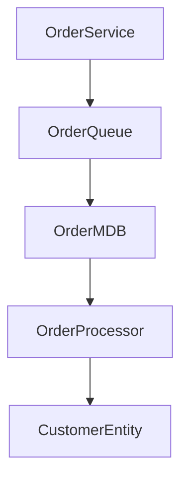
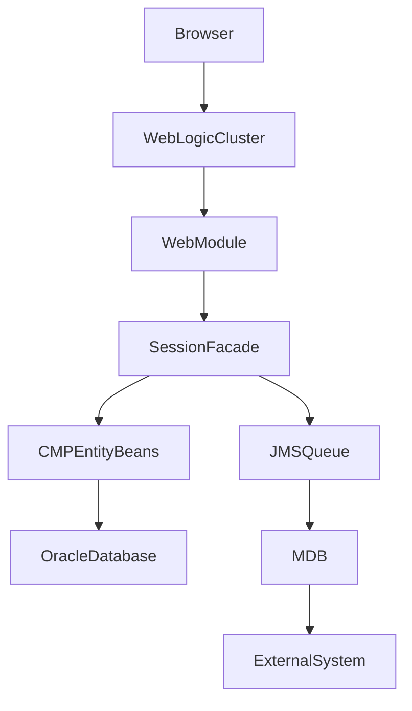

# Deployment Descriptor Documentation Rules

Deployment descriptors are considered primary sources of architectural information.

Always analyse ALL deployment descriptors before documenting Java classes.

The following descriptors must be examined:

## Enterprise Application Descriptors

- application.xml
- weblogic-application.xml

## EJB Descriptors

- ejb-jar.xml
- weblogic-ejb-jar.xml

## Web Application Descriptors

- web.xml
- weblogic.xml

## JMS Descriptors

- weblogic-jms.xml
- JMS module definitions

## Security Descriptors

- weblogic-permissions.xml
- security-role assignments
- policy configurations

## Resource Descriptors

- JDBC datasource definitions
- JMS resource definitions
- Mail Session definitions
- Connection Factory definitions

---

# Documentation Requirements

For every deployment descriptor create:

## Descriptor Summary

| Attribute | Value |
|------------|---------|
| File Name | |
| Purpose | |
| Module Type | |
| Environment Dependencies | |
| Referenced Resources | |

---

# application.xml Analysis

Document:

## Application Structure

Identify:

- EAR Name
- Application Modules
- EJB Modules
- WAR Modules
- Utility JARs

Produce:

### Module Inventory

| Module | Type | Purpose |
|----------|--------|----------|
| | | |

Explain how modules interact.

---

# weblogic-application.xml Analysis

Document:

## WebLogic Configuration

Identify:

- Application libraries
- Shared JAR references
- Classloading configuration
- Security settings
- Context roots
- Deployment targets

Explain:

- Why WebLogic-specific configuration exists
- Potential deployment risks
- Dependencies on WebLogic features

Highlight any vendor lock-in concerns.

---

# ejb-jar.xml Analysis

Document every enterprise bean.

For each bean record:

### Bean Definition

| Property | Value |
|----------|--------|
| EJB Name | |
| Bean Type | |
| Home Interface | |
| Remote Interface | |
| Local Interface | |
| Bean Class | |
| Primary Key Class | |

---

## Transactions

Document:

- Transaction type
- Container managed transactions
- Bean managed transactions
- Transaction attributes

Example:

| Method | Transaction Attribute |
|----------|----------------------|
| createOrder | Required |
| findCustomer | Supports |
| updatePolicy | RequiresNew |

Explain business impact.

---

## Security

Document:

- Security roles
- Method permissions
- Unchecked methods
- Run-as identities

Explain which roles can invoke which business services.

---

# weblogic-ejb-jar.xml Analysis

Document:

## JNDI Bindings

Create:

| Bean | JNDI Name |
|--------|----------|
| | |

Explain:

- Client lookup patterns
- Dependencies between systems
- External integration points

---

## Pooling Configuration

Document:

- Initial bean count
- Maximum bean count
- Cache sizes
- Activation settings

Explain impact on:

- Performance
- Memory consumption
- Scalability

---

## Clustering Configuration

Document:

- Cluster usage
- Replica awareness
- Load balancing configuration
- Failover behaviour

Explain operational implications.

---

# web.xml Analysis

Document:

## Web Components

Identify:

- Servlets
- Filters
- Listeners
- Context parameters
- Session configuration

Create:

### Servlet Inventory

| Servlet | URL Pattern | Purpose |
|----------|-------------|----------|
| | | |

---

## Filter Chain

Document processing order.

Example:

Explain each filter's responsibilities.

---

## Session Management

Document:

- Session timeout
- Cookie settings
- Session tracking mechanisms

Explain impact on user experience and scalability.

---

# weblogic.xml Analysis

Document:

## WebLogic Extensions

Identify:

- Context root
- Security mappings
- Virtual directory mappings
- Session clustering configuration

Describe environment specific behaviour.

---

# JMS Configuration Documentation

When JMS descriptors are found:

Create:

## JMS Resource Map

| Resource | Type | Purpose |
|-----------|--------|----------|
| | | |

Document:

- Connection factories
- Queues
- Topics
- Distributed queues
- Distributed topics

---

## Messaging Dependencies

Create Mermaid diagrams showing producer and consumer relationships.

Example:

---

# Datasource Documentation

For JDBC resources document:

## Datasource Inventory

| Datasource | JNDI Name | Database |
|------------|------------|------------|
| | | |

Document:

- Connection pool sizes
- XA participation
- Transaction support
- Credential handling

Explain application dependencies.

---

# Environment Documentation

Infer environment requirements from descriptors.

Document:

## Infrastructure Dependencies

### Application Server

- Required WebLogic version
- Required patches

### Database

- Database vendor
- JDBC drivers
- Schema requirements

### Messaging

- JMS providers
- Queue definitions

### External Systems

- SOAP services
- File shares
- FTP servers
- REST services

---

# Configuration Cross Reference

Create a traceability section.

Example:

| Business Function | Java Component | Descriptor Configuration |
|--------------------|----------------|-------------------------|
| Order Management | OrderFacadeBean | ejb-jar.xml |
| Customer Updates | CustomerMDB | weblogic-ejb-jar.xml |

This helps support teams locate relevant configuration quickly.

---

# Deployment Diagram Requirements

Always generate a deployment diagram when sufficient information exists.

Example:

---

# Risk Identification

For every descriptor identify:

- Hard coded server names
- Hard coded ports
- Environment dependencies
- Deprecated EJB2 features
- WebLogic proprietary configurations
- Security concerns
- Single points of failure

Provide modernization recommendations where applicable.