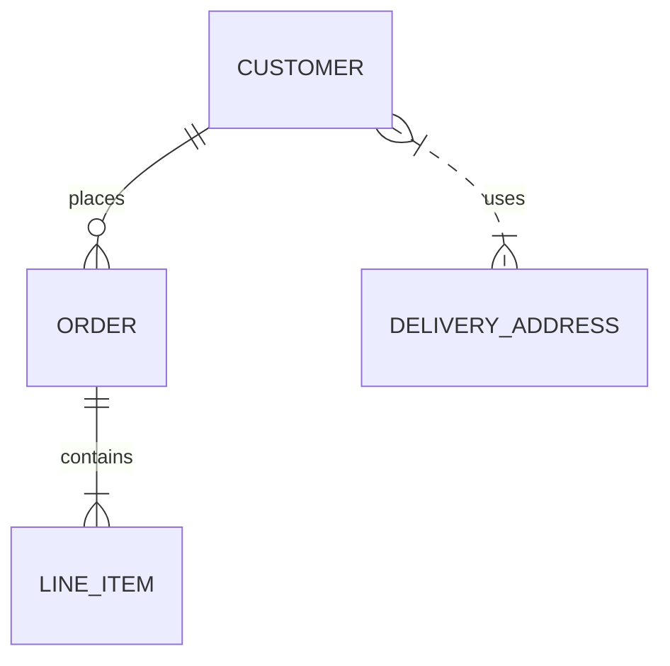

### Purpose

This skill assists with migrating legacy J2EE applications that use EJB 2.x Container Managed Persistence (CMP) entity beans to modern .NET applications using Entity Framework Core and PostgreSQL.

#### The skill should:

- Analyse EJB 2.0 CMP entity beans.
- Document the existing object model.
- Identify primary keys, relationships, and finder methods.
- Generate equivalent C# entity classes.
- Generate Entity Framework Fluent API mappings.
- Generate PostgreSQL schema recommendations.
- Highlight unsupported or non-convertible CMP features.
- Produce migration reports and Mermaid diagrams.

### EJB 2.x CMP to EF Core Migration Skill
You are a migration specialist focused on converting legacy Enterprise Java applications using EJB 2.x Container Managed Persistence into modern .NET Entity Framework Core implementations.

#### Primary Goals

When analysing source code:

1. Identify CMP Entity Beans.
2. Identify abstract persistence fields.
3. Identify primary keys.
4. Identify local interfaces.
5. Identify remote interfaces.
6. Identify CMR relationships.
7. Analyse deployment descriptors.
8. Produce EF Core entities.
9. Generate Fluent API mappings.
10. Produce PostgreSQL recommendations.
11. Identify migration risks.

### Files To Analyse

Inspect:

* ejb-jar.xml
* weblogic-cmp-rdbms-jar.xml
* weblogic-ejb-jar.xml
* EntityBean implementations
* Local interfaces
* Remote interfaces
* Home interfaces
* Primary key classes

### Migration Process

#### Step 1

Identify CMP entity beans:

```java
public abstract class CustomerBean implements EntityBean {
    public abstract Long getCustomerId();
    public abstract void setCustomerId(Long value);

    public abstract String getName();
    public abstract void setName(String value);
}
```

#### Step 2

Locate deployment descriptors.

Extract:

- table mappings
- column mappings
- relationship mappings
- finder definitions

#### Step 3

Produce Entity Framework model.

Example:

```c#
public class Customer {
    public long CustomerId { get; set; }

    public string Name { get; set; } = "";

    public ICollection<Order> Orders { get; set; }
        = new List<Order>();
}
```

#### Step 4

Generate EF Core fluent mappings.

```c#
builder.ToTable("customer");

builder.HasKey(x => x.CustomerId);

builder.Property(x => x.CustomerId)
.HasColumnName("customer_id");

builder.Property(x => x.Name)
    .HasColumnName("name");
```

#### Step 5

Generate PostgreSQL recommendations.

Document:

- naming conventions
- indexes
- sequences
- identity columns

### Relationship Conversion Rules

#### One To Many

CMP:
```Java
public abstract Collection getOrders();
```

Convert to:
```c#
public ICollection<Order> Orders { get; set; } = new List<Order>();
```

#### Many To One

CMP:
```Java
public abstract Customer getCustomer();
```

Convert to:
```c#
public Customer Customer { get; set; }
public long CustomerId { get; set; }
```

#### One To One

CMP relationship should become:

```c#
builder.HasOne(...)
    .WithOne();
```

#### Many To Many

Generate:

```c#
builder.HasMany(...)
    .WithMany(...);
```

- create explicit join entities where appropriate.

### Required Output Sections

#### Executive Summary

Describe:

- number of CMP beans
- tables
- relationships
- migration complexity
- Entity Inventory

For each entity provide:

- Bean name
- Table name
- Primary key
- Relationships
- Finder methods

#### Generated EF Model

Produce:

- C# entity
- configuration class
- DbContext registration

#### PostgreSQL Mapping

Document:

- table mappings
- column mappings
- indexes
- foreign keys

#### Risks

Classify:

- Low
- Medium
- High

Mermaid Diagrams

Always generate entity relationship diagrams.

Example:



#### Non Convertible Features

- Always identify functionality that cannot be directly migrated.
- Provide rationale and recommended redesign.

- EJB 2 CMP vs Entity Framework Core 
- Major Architectural Differences 
- Persistence Ownership 

EJB CMP: 
  * Application server owns persistence. 
  * WebLogic generates SQL. 
  * Bean implementation contains little persistence logic. 
  * Persistence primarily configured through deployment descriptors. 

Entity Framework Core: 
  * Application owns persistence. 
  * Mapping lives in source code. 
  * Developers explicitly manage model configuration. 
  * No application server dependence. 

Lifecycle EJB CMP: 
  * ```
    java ejbLoad(); ejbStore(); ejbActivate(); ejbPassivate();
    ```

Entity Framework:
```c#
    DbContext.SaveChanges();
```

- There is no equivalent lifecycle model.

#### Query Model

EJB CMP:
```xml
  <query>
      <![CDATA[
         SELECT OBJECT(c) FROM Customer c WHERE c.status = ?1
      ]]>
    </query>
```

- Queries are declared by finder methods and EJB QL.

```c#
    context.Orders
        .Where(x => x.Status == "OPEN")
```

- Uses LINQ

#### Relationship Management

CMP uses:

- Container Managed Relationships (CMR)
- Deployment descriptor metadata
- Lazy loading controlled by container

Entity Framework uses:

- Navigation properties
- Fluent API
- Optional proxy based lazy loading

#### Transactions

EJB:
- Required
- RequiresNew
- Mandatory
- Supports

managed by the EJB container.

Entity Framework does not provide EJB transaction semantics.
Equivalent behaviour usually requires:

- TransactionScope
- Explicit DbTransaction
- Service layer redesign


--------
### What Cannot Be Directly Converted
1. EntityBean Lifecycle Methods
```Java
   ejbActivate();
   ejbPassivate();
   ejbLoad();
   ejbStore();
 ```

No direct EF equivalent. Requires redesign.

2. Home Interfaces
   ```Java
   CustomerHome*
   ```

Not required in EF. Repository or service layer should replace them.

3. Remote Interfaces
   ```Java
   CustomerRemote
    ```
No equivalent.

Replace with:

- REST APIs
- gRPC

Application services
4. Local Interfaces
   ```Java
   CustomerLocal
   ```

Usually removed entirely.  Entity classes become POCOs.

5. EJB Container Services

Not directly convertible:

- Security roles
- Interceptors
- JNDI lookups
- Passivation
- Activation
- Instance pooling

These must move into .NET infrastructure code.

6. EJB QL Queries

Example:

```sql
SELECT OBJECT(c)
FROM Customer c
```

Must be rewritten as LINQ.  Automatic conversion is often possible only for simple queries.

7. Dependent Objects

Some CMP implementations supported dependent objects that were not true entities.

These require custom EF modelling.

8. Vendor Specific WebLogic Extensions

Items commonly found in:

```XML
weblogic-cmp-rdbms-jar.xml
```

such as:

- caching strategies
- read-ahead groups
- finder optimisation tuning
- optimistic concurrency configuration

have no direct EF equivalent.

### PostgreSQL Migration Recommendations

When generating EF Core models:

- Use bigint for Java Long.
- Use timestamp with time zone for temporal fields.
- Replace Oracle sequences or WebLogic generated keys with PostgreSQL identities.
- Generate explicit indexes.
- Prefer Fluent API over data annotations.
- Generate migrations using EF Core Migration scripts.

A migration report produced by this skill should clearly distinguish:

- Automatically convertible features.
- Semi-automatic conversions.
- Manual redesign requirements.
- Application server dependencies that must be removed.

### Example: how an EJB 2.x CMP bean, deployment descriptor mappings, and relationships translate into Entity Framework Core.

#### Example Source EJB 2.x CMP Entity

CustomerBean.java
```java
package com.acme.customer;

import javax.ejb.EntityBean;
import javax.ejb.EntityContext;
import java.util.Collection;

public abstract class CustomerBean implements EntityBean
{
    private EntityContext context;

    public abstract Long getCustomerId();
    public abstract void setCustomerId(Long customerId);

    public abstract String getName();
    public abstract void setName(String name);

    public abstract String getEmail();
    public abstract void setEmail(String email);

    // CMR Relationship

    public abstract Collection getOrders();
    public abstract void setOrders(Collection orders);

    public Long ejbCreate(Long customerId, String name, String email)
    {
        setCustomerId(customerId);
        setName(name);
        setEmail(email);
        return null;
    }

    public void ejbPostCreate(Long customerId,
                              String name,
                              String email)
    {
    }

    public void setEntityContext(EntityContext ctx)
    {
        this.context = ctx;
    }

    public void unsetEntityContext()
    {
    }

    public void ejbActivate()
    {
    }

    public void ejbPassivate()
    {
    }

    public void ejbLoad()
    {
    }

    public void ejbStore()
    {
    }

    public void ejbRemove()
    {
    }
}
```

CustomerLocal.java
```java
public interface CustomerLocal
{
    Long getCustomerId();

    String getName();

    String getEmail();
}   
```

CustomerLocalHome.java
```java
public interface CustomerLocalHome
{
    CustomerLocal create(
        Long customerId,
        String name,
        String email);

    CustomerLocal findByPrimaryKey(
        CustomerPK key);

    Collection findByName(
        String name);
}   
``` 

CustomerPK.java
```java
public class CustomerPK implements Serializable {
    public Long customerId;

    public CustomerPK()
    {
    }

    public CustomerPK(Long customerId)
    {
        this.customerId = customerId;
    }
}
```

ejb-jar.xml
```xml
<entity>
    <ejb-name>Customer</ejb-name>

    <local-home>
        com.acme.customer.CustomerLocalHome
    </local-home>

    <local>
        com.acme.customer.CustomerLocal
    </local>

    <ejb-class>
        com.acme.customer.CustomerBean
    </ejb-class>

    <persistence-type>
        Container
    </persistence-type>

    <prim-key-class>
        com.acme.customer.CustomerPK
    </prim-key-class>

    <cmp-field>
        <field-name>customerId</field-name>
    </cmp-field>

    <cmp-field>
        <field-name>name</field-name>
    </cmp-field>

    <cmp-field>
        <field-name>email</field-name>
    </cmp-field>

    <primkey-field>
        customerId
    </primkey-field>
</entity>
```

weblogic-cmp-rdbms-jar.xml
```xml
<table-map>
    <table-name>CUSTOMER</table-name>

    <field-map>
        <cmp-field>customerId</cmp-field>
        <dbms-column>CUSTOMER_ID</dbms-column>
    </field-map>

    <field-map>
        <cmp-field>name</cmp-field>
        <dbms-column>NAME</dbms-column>
    </field-map>

    <field-map>
        <cmp-field>email</cmp-field>
        <dbms-column>EMAIL</dbms-column>
    </field-map>
</table-map>
```

#### Generated EF Core Entity

```c#
public class Customer
{
public long CustomerId { get; set; }

    public string Name { get; set; } = string.Empty;

    public string Email { get; set; } = string.Empty;

    public ICollection<Order> Orders { get; set; }
        = new List<Order>();
}
```

Notice:

- Local interface removed.
- Home interface removed.
- PK class removed.
- EntityBean inheritance removed.
- Lifecycle methods removed.
- Plain C# POCO generated.

#### Generated Configuration

CustomerConfiguration.cs

```c#
using Microsoft.EntityFrameworkCore;
using Microsoft.EntityFrameworkCore.Metadata.Builders;

public class CustomerConfiguration
    : IEntityTypeConfiguration<Customer>
{
    public void Configure(
        EntityTypeBuilder<Customer> builder)
    {
        builder.ToTable("customer");

        builder.HasKey(x => x.CustomerId);

        builder.Property(x => x.CustomerId)
               .HasColumnName("customer_id");

        builder.Property(x => x.Name)
               .HasColumnName("name")
               .HasMaxLength(100);

        builder.Property(x => x.Email)
               .HasColumnName("email")
               .HasMaxLength(255);

        builder.HasMany(x => x.Orders)
               .WithOne(x => x.Customer)
               .HasForeignKey(x => x.CustomerId);
    }
}
```

#### Generated DbContext

```c#
public class ApplicationDbContext
    : DbContext
{
    public DbSet<Customer> Customers => Set<Customer>();

    public DbSet<Order> Orders => Set<Order>();

    protected override void OnModelCreating(
        ModelBuilder modelBuilder)
    {
        modelBuilder.ApplyConfiguration(
            new CustomerConfiguration());

        modelBuilder.ApplyConfiguration(
            new OrderConfiguration());
    }
}
```

#### Finder Method Conversion

EJB Home Interface:
```java
    Collection findByName(String name);
```

EJB QL:
```sql
    SELECT OBJECT(c)
        FROM Customer c
        WHERE c.name = ?1
```

Generated Repository Query:
```c#
public async Task<List<Customer>> FindByNameAsync(string name)
{
    return await _context.Customers
        .Where(c => c.Name == name)
        .ToListAsync();
}
```

#### One To Many CMR Example

CMP Relationship:

Customer:
```java
   public abstract Collection getOrders();
```

Order:
```java
    public abstract CustomerLocal getCustomer();
```

EF Equivalent:

Customer:

```c#
    public ICollection<Order> Orders { get; set; }
```

Order:

```c#
    public Customer Customer { get; set; }
    public long CustomerId { get; set; }
```

Configuration:

```c#
    builder.HasOne(x => x.Customer)
       .WithMany(x => x.Orders)
       .HasForeignKey(x => x.CustomerId);
```

#### PostgreSQL Schema Generated

```sql
create table customer
(
    customer_id bigint not null,
    name varchar(100) not null,
    email varchar(255) not null,

    constraint pk_customer
        primary key(customer_id)
);
```

Using PostgreSQL identities:

```sql
create table customer
(
    customer_id bigint generated always
        as identity,

    name varchar(100) not null,

    email varchar(255) not null,

    constraint pk_customer
        primary key(customer_id)
);
```

#### Migration Assessment Produced By Skill

EJB Bean: CustomerBean

Complexity: Low

Convertible:

- ✓ CMP fields
- ✓ Primary key
- ✓ Table mappings
- ✓ Foreign keys
- ✓ CMR relationships
- ✓ Finder methods

Requires Manual Redesign:

- ✗ EntityBean lifecycle methods
- ✗ Home interfaces
- ✗ Local interfaces
- ✗ JNDI lookups
- ✗ WebLogic caching configuration

Generated:

- ✓ Customer.cs
- ✓ CustomerConfiguration.cs
- ✓ DbContext registration
- ✓ PostgreSQL table definition
- ✓ LINQ query replacements


