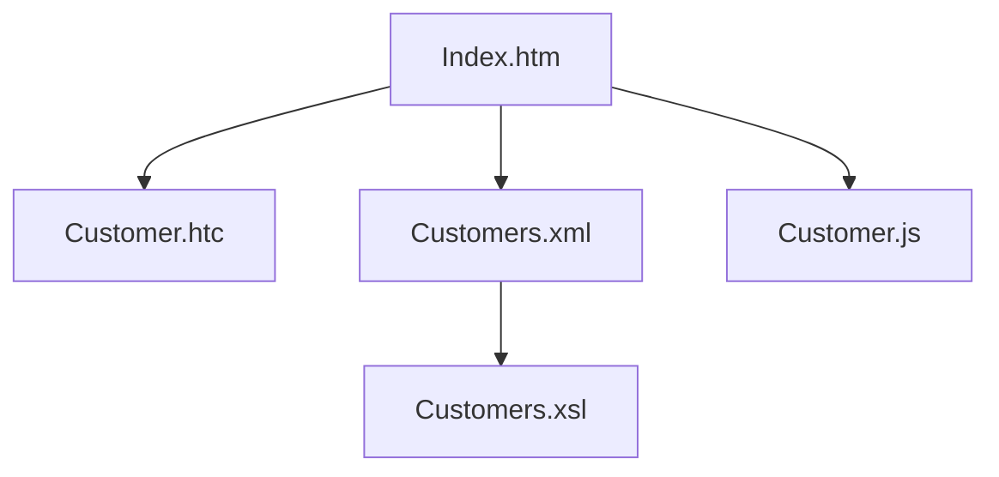
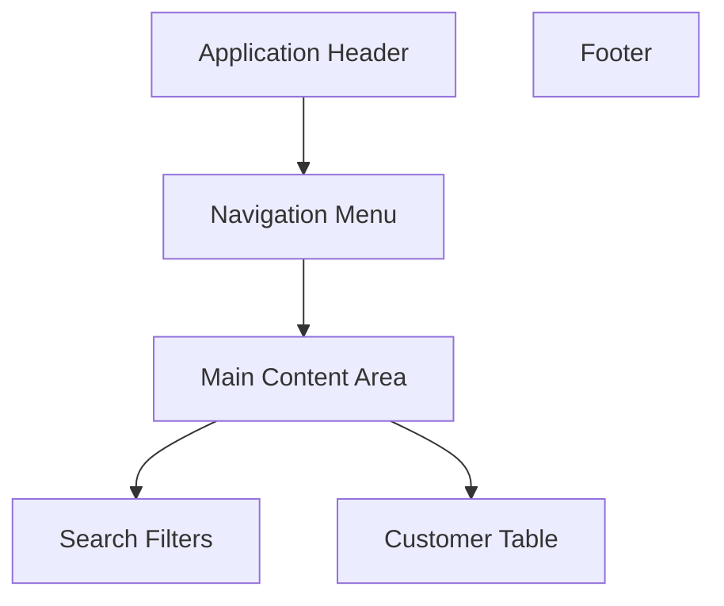

## GitHub Copilot Skill: Legacy Web UI Documentation and Reconstruction

### Purpose
This skill helps engineers understand, document, modernize, and reconstruct legacy browser-based applications that use:

- Microsoft HTML Components (HTC files)
- Internet Explorer specific technologies
- HTML 3.x / HTML 4.x applications
- CSS stylesheets
- XML data islands
- XSL and XSLT transformations
- JavaScript and JScript
- DHTML behaviours
- Framesets and table-based layouts
- ActiveX integrations
- Legacy ASP and JSP generated content
  The skill analyses the complete user interface stack and reconstructs how pages would have appeared and behaved within Internet Explorer.


### Supported Technologies
Microsoft HTML Components
Identify and document:

- .htc files
- CSS behavior bindings
- Element behaviours
- Attached custom events
- Exposed properties
- Public methods
- Data binding functionality
- Client side business rules


  Example:

```html
<style>
.customer {
    behavior:url(customer.htc);
}
</style>
```

Document:
- Which elements consume the component
- Behaviour lifecycle
- Event model
- Browser dependencies
- Reusable UI functionality


### XML and XSLT
Analyse:

- XML data sources
- XML Data Islands
- XSL stylesheets
- XSLT transformations
- Dynamic rendering logic
- DOM manipulation


Example:

```html
<xml id="customers" src="customers.xml"></xml>
```

```html
<table datasrc="#customers">
```

Document:

- Source XML schema
- Data relationships
- Transformation flow
- Generated HTML output
- Dependencies between XML and XSL


### JavaScript and JScript
Analyse:

- Global scripts
- Inline scripts
- Browser specific APIs
- ActiveXObject usage
- DOM manipulation
- Event handling
- Form validation
- Navigation flows
  
Document:

- Call hierarchy
- Event chain
- Data flow
- Browser dependencies
- Security concerns


### CSS Analysis
Document:

- Stylesheets
- Imported CSS
- Behaviour bindings
- Layout techniques
- Browser specific hacks
- Positioning strategies

Identify:

- IE specific selectors
- CSS Expressions
- Behaviour URLs
- Deprecated constructs


### Analysis Workflow
### Step 1
Inventory all UI assets.

Discover:

- HTML
- HTC
- CSS
- XML
- XSL
- XSLT
- JavaScript
- Images
- ActiveX controls


### Step 2
Build dependency model.

Produce Mermaid diagrams.

Example:



### Step 3
Reconstruct rendering sequence.

Document:

1. Page load
2. CSS loading
3. HTC attachment
4. XML loading
5. XSL transformation
6. DOM creation
7. Event registration
8. User interaction lifecycle

### Step 4
Generate architecture documentation.


### UI Reconstruction Requirements
The skill must reconstruct the user interface from source artefacts.

#### Reconstructed View
Produce:

- Page layout description
- Navigation areas
- Forms
- Tables
- Menus
- Toolbars
- Dialogs
- Tabs
- Dynamic regions


#### HTML Mockup Generation
Generate a modern equivalent web page that approximates the original rendering.

Include:

- Semantic HTML
- Recreated CSS
- Placeholder data
- Functional JavaScript stubs

#### Visual Wireframe
Generate Mermaid wireframes.
  
Example:




### Documentation Template
For each page create:

#### Overview
- Describe business purpose.
- Technologies Used List: HTML, HTC, CSS , XML, XSLT, JavaScript, 
- Dependencies
- Provide dependency diagram.
- Render Flow
- Explain runtime behaviour.


#### Events
Document:

- onload
- onclick
- onchange
- custom HTC events

#### Data Sources

Describe:

- XML files
- Backend endpoints
- Generated content


#### Browser Dependencies
Identify:

- Internet Explorer versions
- ActiveX requirements
- DHTML features
  
#### Security Observations
  Highlight:

- ActiveX usage
- Script injection risks
- Legacy browser concerns


### Modernisation Guidance
Recommend replacements such as:

- Web Components
- Custom Elements
- React
- Modern CSS
- JSON APIs


### Rules

1. Always identify all HTC files.
2. Reconstruct the runtime behaviour of each HTC component.
3. Explain XML to XSLT transformation pipelines.
4. Create Mermaid dependency diagrams.
5. Create Mermaid UI layout diagrams.
6. Produce a browser rendering narrative.
7. Reconstruct the likely rendered page.
8. Describe Internet Explorer specific functionality.
9. Highlight migration risks.
10. Generate modern HTML equivalents where practical.
11. Document CSS behaviours and layout techniques.
12. Trace JavaScript event flows.
13. Explain ActiveX usage and COM interactions.
14. Identify unsupported browser features.
15. Clearly separate confirmed behaviour from inferred behaviour.


