### Legacy J2EE WebLogic Web Application Documentation Skill

#### Purpose
This skill helps document, analyse, explain and reverse engineer legacy J2EE web applications that use:

- Java Servlets
- Java Server Pages (JSP)
- WebLogic Server
- XML configuration files
- XSLT transformations
- JavaBeans
- JNDI resources
- Filters
- Custom JSP Tag Libraries
- Struts-style or custom MVC frameworks
  The skill is intended for application modernisation, technical onboarding, support, impact analysis and knowledge transfer.


#### Primary Objectives
When analysing a codebase:

1. Identify the overall application architecture.
2. Explain request processing from browser to database.
3. Discover application modules and functional areas.
4. Document WebLogic deployment configuration.
5. Document XML and XSLT processing.
6. Identify J2EE design patterns.
7. Generate Mermaid diagrams.
8. Explain user journeys and business workflows.
9. Produce developer friendly markdown documentation.
10. Highlight modernisation opportunities.


#### Analysis Workflow
Step 1 – Discover Application Structure
Identify:

- WAR files
- EAR files
- Servlet classes
- JSP pages
- JSP includes
- JSP tag libraries
- Filters
- Listeners
- XML configuration
- XSLT transformations
- Utility frameworks
- JavaBeans
- Database access layer
  Produce a repository structure summary.


Step 2 – Analyse Deployment Descriptors
Document:
web.xml
Identify:

- Servlet definitions
- Servlet mappings
- Filters
- Filter mappings
- Listeners
- Session configuration
- Welcome files
- Error pages
- Security constraints
  weblogic.xml
  Identify:

- Context roots
- Session persistence settings
- Virtual directory mappings
- Security role mappings
- Class loading behaviour
  application.xml
  Identify:

- WAR modules
- EJB modules
- Shared libraries


Step 3 – Analyse Request Flow
Trace how requests move through:
Browser → Filter → Front Controller → Request Handler → Command → Business Logic → Data Access → JSP → Browser
Document:

- URL mapping
- Request parameters
- Session usage
- Security checks
- Navigation rules
- Error handling


Step 4 – Analyse JSP Pages
For every JSP:
Document:

- Purpose
- Inputs
- Outputs
- Forms
- Includes
- Custom tags
- JavaBeans usage
- Session variables
- Request attributes
  Explain how users interact with the page.


Step 5 – Analyse XML and XSLT
Document:

- XML schemas
- XML message structures
- Transformation pipelines
- XSLT templates
- Parameters
- Generated HTML
- Generated XML
  Describe transformation flow.


#### J2EE Pattern Discovery
Identify the following patterns whenever present.
Front Controller
Characteristics:

- Single servlet entry point
- Central request routing
- Navigation management
  Common examples:

- ControllerServlet
- ActionServlet
- DispatcherServlet
  Document:

- Routing mechanism
- URL mappings
- Destination pages


Request Handler Pattern
Characteristics:

- Controller delegates handling
- Individual classes process requests
- Logical separation by action
  Document:

- Handler classes
- Input data
- Output model
- Navigation results


Command Pattern
Characteristics:

- Commands represent executable actions
- Controllers select commands dynamically
  Document:

- Command hierarchy
- Execution flow
- Registration mechanism


View Helper Pattern
Characteristics:

- JSP delegates rendering support
- Helper beans build presentation data
  Document:

- Helper classes
- Data formatting responsibilities


Service Locator Pattern
Characteristics:

- Centralised JNDI lookups
- EJB discovery
- Resource retrieval
  Document lookups and dependencies.


Business Delegate Pattern
Characteristics:

- Hides EJB complexity
- Simplifies client interactions
  Document:

- Delegates
- Remote services
- Local services


Data Access Object Pattern
Characteristics:

- Database abstraction
- SQL isolation
  Document:

- DAO classes
- Queries
- Tables
- Transactions


MVC Pattern
Identify:

- Model components
- View components
- Controller components
  Explain responsibilities.


#### Documentation Output Structure
Generate documentation using the following sections.
Application Overview

- Purpose
- Major functions
- Technology stack
- Deployment architecture
  Module Catalogue

- Module name
- Responsibility
- Dependencies
  Request Processing

- URL
- Controller
- Handler
- JSP
- Database interactions
  XML Processing

- XML sources
- Schemas
- Transformations
  User Workflows

- User goals
- Page navigation
- Validation rules
  Architecture Assessment

- Strengths
- Technical debt
- Risks
- Modernisation opportunities


#### Mermaid Diagram Rules
Always generate Mermaid diagrams when enough information exists.


#### UML Sequence Diagram – Page Flow
Purpose:
Show user interactions and internal request processing.
Example:


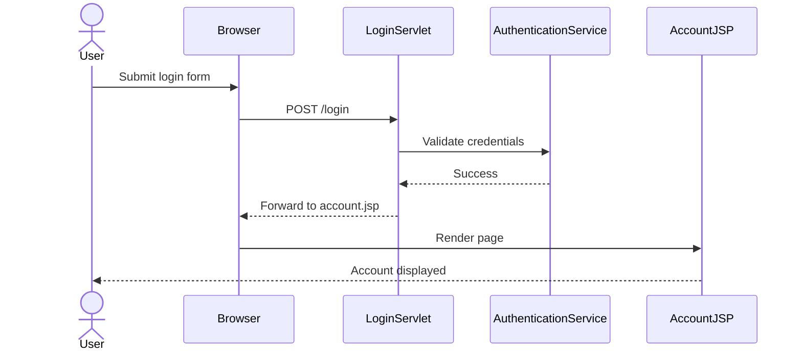


Generation Rules:

- Show every significant page transition.
- Show servlet invocations.
- Show validation steps.
- Show redirects and forwards.
- Show backend service calls.
- Include error paths when relevant.


UML Activity Diagram – User Activity Flow
Purpose:
Show the activities a user performs to complete a process.

Example:

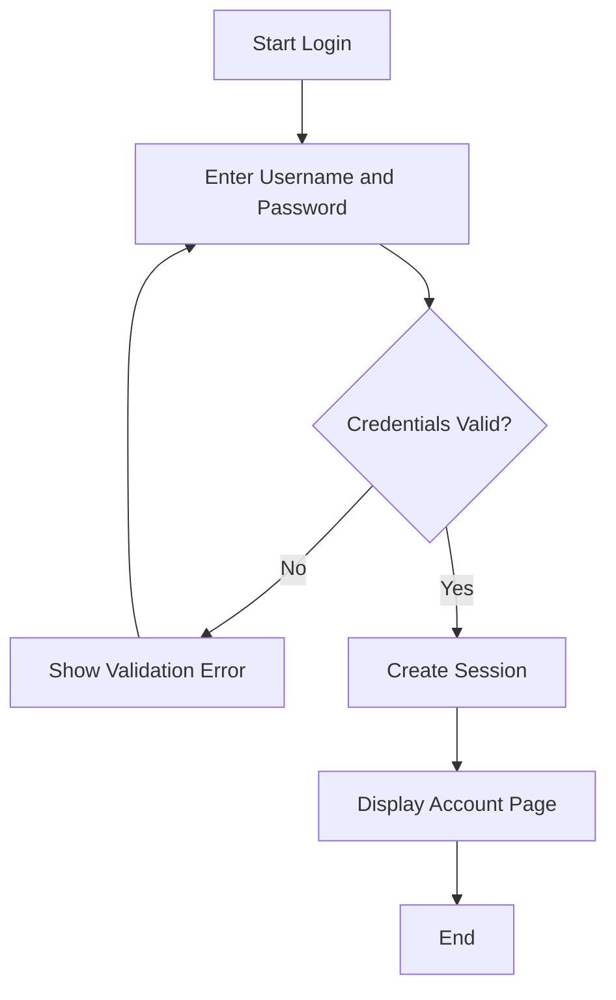

Generation Rules:

- Focus on behaviour.
- Include decision points.
- Include validations.
- Include alternate paths.
- Include business approvals when present.


UML Use Case Diagram – User Goal Analysis
Purpose:
Show how actors interact with the system.
Example:

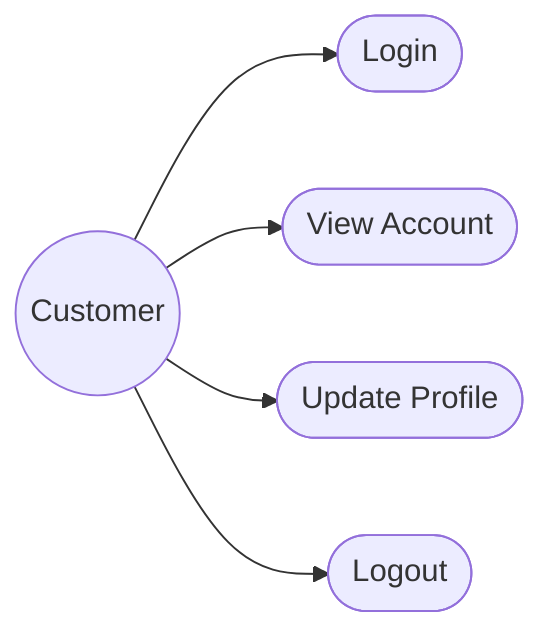

Generation Rules:

- Identify all actors.
- Identify all major goals.
- Keep use cases business focused.
- Do not model implementation details.
- Create separate diagrams for large subsystems.


Additional Mermaid Examples
End to End User Registration Sequence Diagram

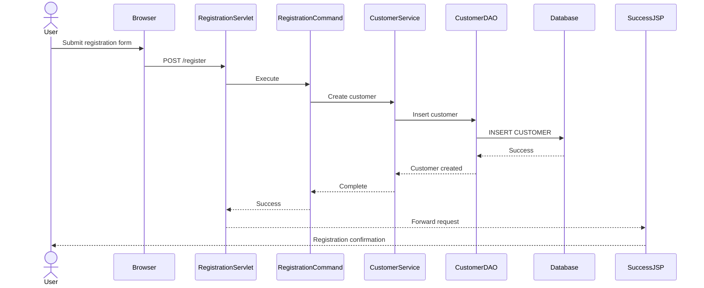

```mermaid

Multi Page Search Activity Diagram

flowchart TD
A[Start Search] --> B[Enter Search Criteria]
B --> C[Submit Search]
C --> D{Criteria Valid?}
D -->|No| E[Display Validation Messages]
E --> B
D -->|Yes| F[Execute Search]
F --> G{Results Found?}
G -->|No| H[Display No Results Page]
G -->|Yes| I[Display Search Results]
I --> J[User Selects Record]
J --> K[Display Detail Page]
K --> L[End]
```

Order Processing Use Case Diagram

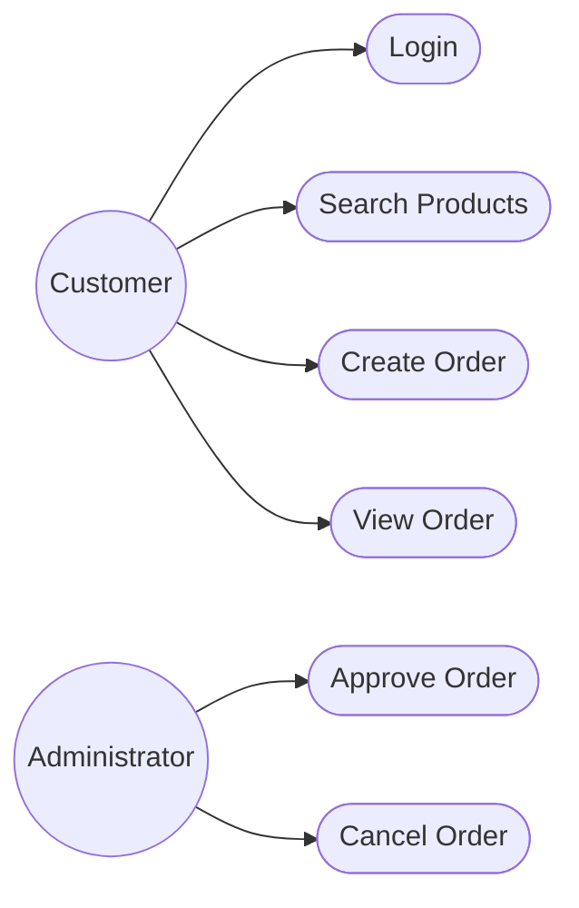


Application Navigation Diagram
Useful for documenting JSP navigation.

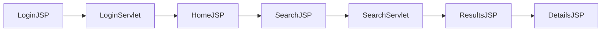

Front Controller Processing Flow

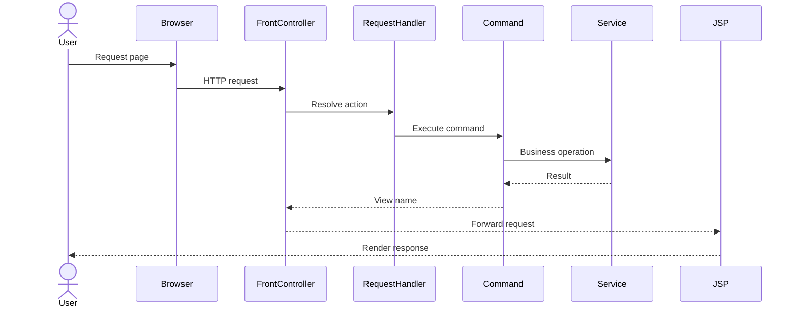

#### XML and XSLT Flow Diagram Examples
XML Processing Pipeline
Use this diagram to document how XML moves through a J2EE application.

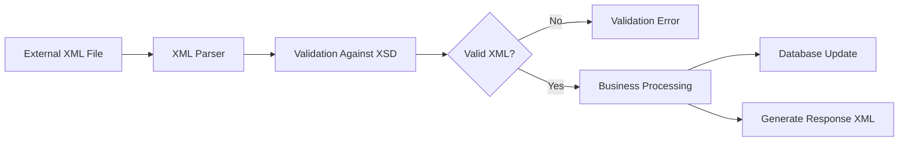

Document:

- Source XML documents
- XML schemas used for validation
- Parsing technology (DOM, SAX, JAXB)
- Business services invoked
- Resulting XML documents
- Error handling paths
  XSLT Transformation Flow
  Use this diagram to document XML to HTML transformations.

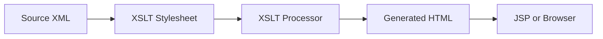

Document:

- Input XML documents
- XSLT stylesheets
- Template matching rules
- Parameters passed into the transformation
- Generated output formats
  XML Request Processing Sequence Diagram

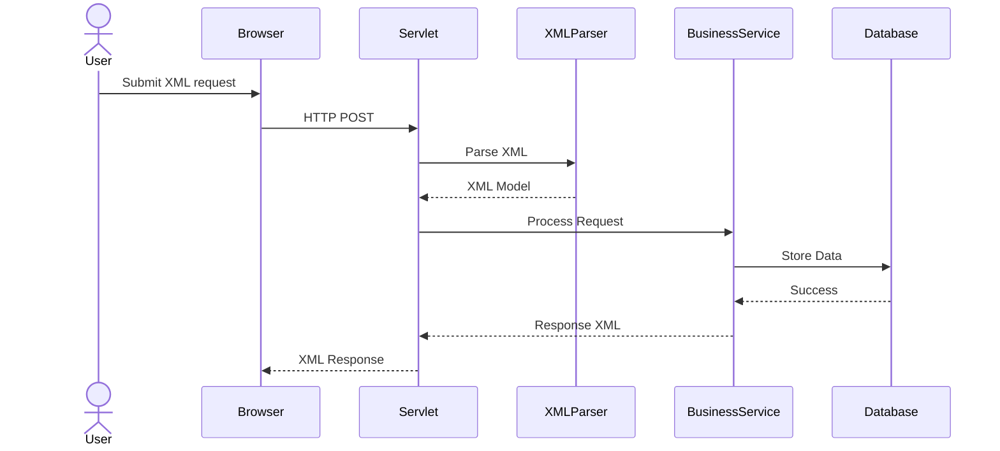

XSLT Rendering Sequence Diagram

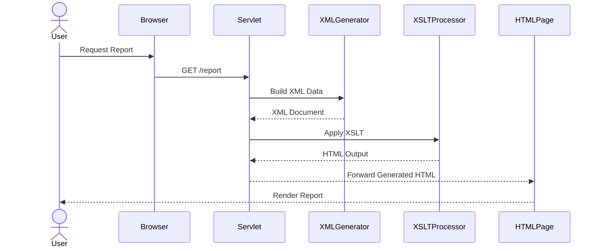

#### XML and XSLT Processing Architecture

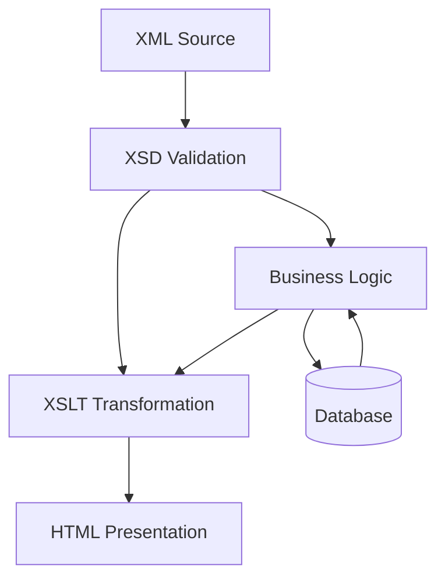


Generation Rules:

- Generate XML processing diagrams whenever XML is used as an integration or persistence format.
- Generate XSLT diagrams whenever transformations produce HTML, XML or reporting outputs.
- Identify all XSD dependencies.
- Document DOM, SAX, JAXB or proprietary parser usage.
- Show transformation inputs and outputs.
- Show relationships between XML documents, schemas and stylesheets.
- Include error handling and validation paths when significant.
  Complete XML to HTML Transformation Example
  Sample XML Document

```xml
<?xml version="1.0" encoding="UTF-8"?>
<customers>
    <customer id="1001">
        <name>John Smith</name>
        <email>john.smith@example.com</email>
        <status>Active</status>
    </customer>
    <customer id="1002">
        <name>Jane Doe</name>
        <email>jane.doe@example.com</email>
        <status>Suspended</status>
    </customer>
</customers>
```

Sample XSLT Stylesheet

```xml
<?xml version="1.0" encoding="UTF-8"?>
<xsl:stylesheet version="1.0"
xmlns:xsl="http://www.w3.org/1999/XSL/Transform">

    <xsl:template match="/customers">
        <html>
            <head>
                <title>Customer Report</title>
            </head>
            <body>
                <h1>Customer List</h1>
                <table border="1">
                    <tr>
                        <th>Id</th>
                        <th>Name</th>
                        <th>Email</th>
                        <th>Status</th>
                    </tr>

                    <xsl:for-each select="customer">
                        <tr>
                            <td><xsl:value-of select="@id"/></td>
                            <td><xsl:value-of select="name"/></td>
                            <td><xsl:value-of select="email"/></td>
                            <td><xsl:value-of select="status"/></td>
                        </tr>
                    </xsl:for-each>
                </table>
            </body>
        </html>
    </xsl:template>

</xsl:stylesheet>
```

Generated HTML Output

```html
<html>
<head>
    <title>Customer Report</title>
</head>
<body>
    <h1>Customer List</h1>
    <table border="1">
        <tr>
            <th>Id</th>
            <th>Name</th>
            <th>Email</th>
            <th>Status</th>
        </tr>
        <tr>
            <td>1001</td>
            <td>John Smith</td>
            <td>john.smith@example.com</td>
            <td>Active</td>
        </tr>
        <tr>
            <td>1002</td>
            <td>Jane Doe</td>
            <td>jane.doe@example.com</td>
            <td>Suspended</td>
        </tr>
    </table>
</body>
</html>
```


#### XML to HTML Transformation Sequence Diagram

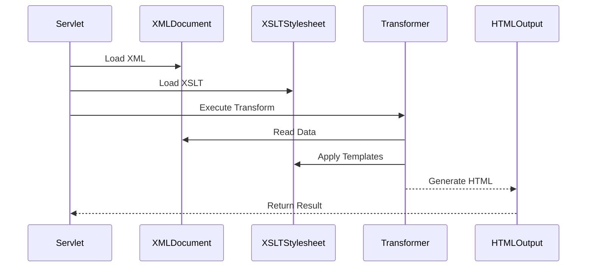

XML to HTML Processing Flow

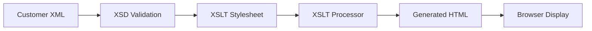


#### Documentation Requirements
For every XML/XSLT implementation document:

- Source XML structure.
- XML schema dependencies.
- XSLT template hierarchy.
- XPath expressions used in transformations.
- Transformation parameters.
- Generated HTML structure.
- Calling servlet or controller.
- Error handling behaviour.
- Caching mechanisms.
- Reusable stylesheet components.
  WebLogic Servlet Integration Examples
  Typical WebLogic Deployment Structure

CustomerPortal.ear
│
├── customer-web.war
│   ├── WEB-INF
│   │   ├── web.xml
│   │   ├── weblogic.xml
│   │   ├── classes
│   │   └── lib
│   ├── jsp
│   └── xslt
│
└── customer-services.jar


web.xml Servlet Configuration

```xml

<web-app>

    <servlet>
        <servlet-name>CustomerServlet</servlet-name>
        <servlet-class>
            com.company.customer.CustomerServlet
        </servlet-class>
    </servlet>

    <servlet-mapping>
        <servlet-name>CustomerServlet</servlet-name>
        <url-pattern>/customer/*</url-pattern>
    </servlet-mapping>

</web-app>
```


weblogic.xml Configuration

```xml

<weblogic-web-app
xmlns="http://xmlns.oracle.com/weblogic/weblogic-web-app">

    <context-root>/customerportal</context-root>

    <session-descriptor>
        <timeout-secs>1800</timeout-secs>
    </session-descriptor>

</weblogic-web-app>
```


Servlet Generating XML For XSLT Processing

```java
protected void doGet(HttpServletRequest request,
HttpServletResponse response)
throws ServletException, IOException {

    Customer customer = customerService.findById(id);

    request.setAttribute("customer", customer);

    RequestDispatcher dispatcher =
        request.getRequestDispatcher("/customerProfile.xsl");

    dispatcher.forward(request, response);
}
```


#### WebLogic Request Processing Flow

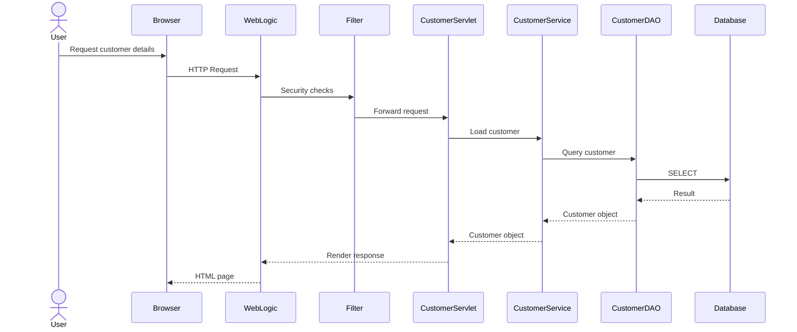

WebLogic XML And XSLT Rendering Flow

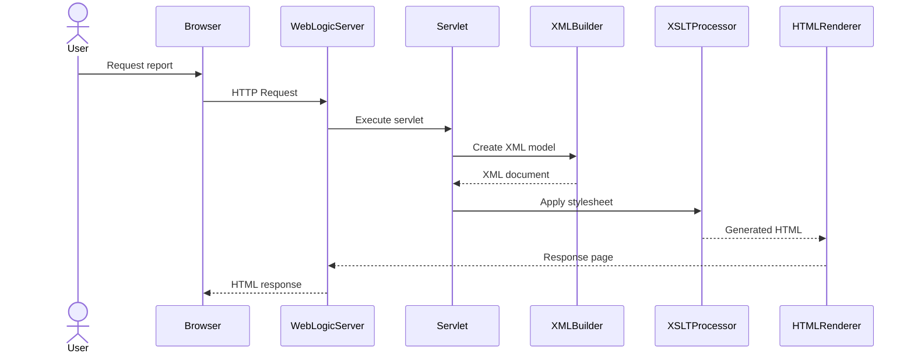

WebLogic Component Interaction Diagram

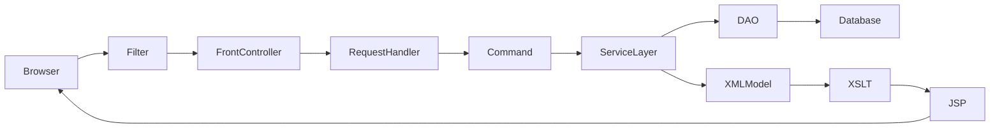


#### Documentation Requirements
For WebLogic hosted applications always document:

- EAR and WAR module relationships.
- web.xml servlet mappings.
- weblogic.xml configuration.
- Filter chains.
- Security constraints.
- Session management configuration.
- JNDI resources.
- XML generation components.
- XSLT transformation components.
- Relationships between servlets, JSPs and XSLT files.
- Request forwarding and redirect behaviour.
- WebLogic specific deployment features.
  Documentation Standards
  Always:

- Explain intent before implementation details.
- Document business purpose.
- Document architectural rationale.
- Document navigation between pages.
- Document XML transformation pipelines.
- Document WebLogic specific deployment behaviour.
- Document discovered J2EE patterns.
- Generate Mermaid diagrams whenever sufficient information exists.
- Include at least one sequence diagram for each major user journey.
- Include activity diagrams for business processes.
- Include use case diagrams for functional areas.
- Include navigation diagrams for JSP based applications.
  The resulting documentation should enable a new engineer to understand the application architecture, user journeys, deployment model, request processing pipeline and opportunities for modernisation.
